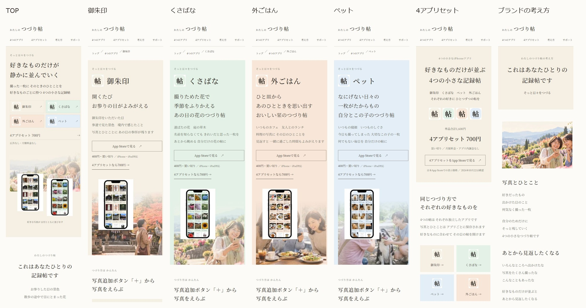

# 公開前修正・品質監査｜2026-10-23

制作ブランチ `site-renewal-cpf-20261021` のみ。基準 `cb825ff1a8cb883951ac3cda90979d8589284e62` を改修。本番公開・mainマージ・BASE・ASC・LINE・広告の変更は行っていません。

## 全7ページのスマートフォン画面

各リンクは390px指定の実ブラウザ全画面。画像を開くと全文を確認できます。Windowsローカル環境がなくても、このGitHub資料から閲覧できます。

|TOP|御朱印|くさばな|外ごはん|ペット|Bundle|考え方|
|---|---|---|---|---|---|---|
|[全画面](top.jpg)|[全画面](goshuin.jpg)|[全画面](kusabana.jpg)|[全画面](sotogohan.jpg)|[全画面](pet.jpg)|[全画面](bundle.jpg)|[全画面](story.jpg)|

`review.html` は7画面を個別スクロールできる保存用レビュー。GitHubではこのMarkdownと画像を直接閲覧できます。

## 正式1.3スクショとの比較

正式4画像をDriveから取得し、画像そのものを目視確認しました。単なる同素材判定ではなく、文字の強弱・配置・透明感・色面・余白・購入導線を比較しています。

|テーマ|比較画像|正式原本|
|---|---|---|
|御朱印|[並列比較](comparison-goshuin.jpg)|[Drive 1枚目](https://drive.google.com/file/d/1POGuHlfCrjnm-yfPab5o8hsZJQ2UTQBO/view)|
|くさばな|[並列比較](comparison-kusabana.jpg)|[Drive 1枚目](https://drive.google.com/file/d/1ih1kfed6FYGAWel5I17gdlAYO8JxOpfA/view)|
|外ごはん|[並列比較](comparison-sotogohan.jpg)|[Drive 1枚目](https://drive.google.com/file/d/1wHjmRMK7Brmue50hQP6G4hBLug-gnZuh/view)|
|ペット|[並列比較](comparison-pet.jpg)|[Drive 1枚目](https://drive.google.com/file/d/1D3bWm6LKATzcnTyw_7sabmJueKwIr4Fk/view)|

- **書体・強弱**：Noto Serif JP自己配信を維持。テーマ名と主コピーを分離し、主コピーはスマホ25px・広幅30px。本文は原則16px。画像内の正式ロゴ・アイコンを独自描画で差し替えていません。ヘッダーは既存の文字組、正式ロゴ素材は既存OGPに維持しています。
- **実画面と情景**：従来の中央画面＋横長写真から、画面を左寄り、情景を右下に置く関係へ変更。上側をCSSで淡く抜き、正式スクショの余白とのつながりを調整しました。Webは縦に読むため、コピーの下に画像を置きます。
- **写真**：採用済み20素材とUI内容を維持。情景は正式素材群の別カットを含み、スクショと写真まで完全同一とは判定しません。例えば正式ペット1枚目は室内の猫、Web採用素材は屋外の犬です。テーマのつながりと表現の関係を比較しています。
- **4色**：御朱印 `#F5EFE4`、くさばな `#E4F1E6`、外ごはん `#F8E6D8`、ペット `#E3EEF7` を各ヒーロー・カード画像面・テーマ選択に使用。背景全面の素材感、帆布テクスチャは追加していません。
- **カード・余白**：4テーマの構成と余白を共通化。カード本文の箱を背景へなじませ、写真を色面から自然に出す設計へ調整しました。
- **購入導線**：濃緑の塗りボタンを落ち着いた枠線へ変更。52px以上の高さと文字のコントラストを維持。価格は単品400円・4本700円、強い煽りや割引率表示は追加していません。

Webとストアを同じテンプレートにするのではなく、主コピー・色・明朝・画面と写真の関係に連続性を持たせた実装です。この監査は公開承認を代替しません。

## コピー差分と出典

分類は **①原典・正式クリエイティブと一致（Web改行・空白調整を除く）／②正式説明文から短縮・編集／③AIによる新規表現**。③をブランド固定コピーとして承認済みとは扱いません。

原典： [ブランド原典](https://docs.google.com/document/d/1saFNKpgsd_e-Yjv-QZMRQcmBIbLKbnUMOcAMU3L-faA/edit)、[BASE原文アーカイブ](https://docs.google.com/document/d/18gCZ_5fqUtXYtoQ8PUwxz-4Oi6vojqx1Pmts6LAg-D8/edit)、[申請マトリクス](https://docs.google.com/spreadsheets/d/15gjxIBfm1MOf8IrF4Rzv4ZQzndRuROMHs6qOUGGeKok/edit)。指定3タブを確認しました。

|箇所|旧サイト|修正後|分類・出典／最新説明文との関係|
|---|---|---|---|
|TOP主見出し|好きなものだけが 静かに並んでいく|維持|① BASE TOP原文。ストアにも「好きなものだけが…並んでいきます」の体験がある|
|御朱印主コピー（TOP・個別）|開くたび お参りの日がよみがえる|維持|① 正式1.3スクショ1枚目の冒頭2行。公開説明冒頭も同じ価値|
|くさばな主コピー（TOP・個別）|散歩道で見つけた 小さな季節を|撮りためた花で 季節をふりかえる あの日の花のつづり帖|旧③→① 正式1.3スクショ1枚目。公開説明「撮りためた写真を見返す」「季節の移ろい」に連続|
|外ごはん主コピー（TOP・個別）|おいしかった日の ひとときまで|ひと皿から あのひとときを思い出す おいしい栞のつづり帖|旧③→① 正式1.3スクショ1枚目。公開説明「一緒に過ごした人やその日の気持ちがよみがえります」に連続|
|ペット主コピー（TOP・個別）|似た写真も 一枚ずつ違う毎日|なにげない日々の 一枚がたからもの 自分とこの子のつづり帖|旧③→① 正式1.3スクショ1枚目。公開説明の「似ているようで、一枚ずつ違う、大切なペットとの毎日」に連続|
|個別冒頭補助コピー|写真とひとことを残す iPhoneアプリ|そっと日々をつづる|① ブランド原典3-6、単品アプリの共通コピー。テーマ主コピーと役割を分ける|
|Bundle主見出し・共通帯|好きなものが いくつもある人へ|好きなものだけが並ぶ 4つの小さな記録帖|旧③→② 公開Bundle説明冒頭「好きなものだけが並ぶ、4つの小さな記録帖」の読点を省いた編集。ブランド原典の逐語コピーとは分類しない|
|操作見出し（4本）|写真追加ボタン「＋」から 今日の一枚を|写真追加ボタン「＋」から 写真をえらぶ|② 公開説明の「写真追加ボタン『＋』」「写真を選んで追加」を短縮。日々の義務に見える文言を削除|
|考え方冒頭|これはあなたひとりの 記録帖です|維持|① ブランド原典3-4。原典の句読点なしを優先（App Store本文は読点あり）|
|考え方本文|AI新規の比喩・句読点あり|好きだったもの／出かけた日のこと／何気なく撮った一枚…好きなものだけが並ぶと／あとから見返したくなる／自分の暮らしが少し見えてくる|① BASE TOP原文の行をそのまま使用。記録→時間が経つ→見返す→気づく体験を維持|
|考え方結び|これはそんなあなたひとりのためのつづり帖です|維持|① ブランド原典3-4。句読点なし|
|循環コピー|今日をつづる 明日出かけたくなる|維持|① ブランド原典3-6。単品コピー・最上位コピーへ置き換えない|
|最上位|明日をつづろう|維持|① ブランド原典3-6|
|TOPカタログ見出し|あなたの好きなものは どの帖に|維持|③ 既存Webの案内文。ブランドの正式コピーではなくレビュー対象のUI文言|
|Bundle本文見出し|同じつづり方で それぞれの好きなものを／写真とひとことだけで その日が残る|維持|③ 既存Webの構成見出し。内容は公開説明の4本独立・写真＋ひとことに基づくが、逐語の正式コピーではない|
|共通操作・案内|写真を撮る・えらぶ／ひとことを添える／あとから見返す／ご購入前に／ほかのつづり帖|維持|② 操作3見出しは公開説明の短縮。③「ご購入前に」「ほかのつづり帖」はWebの案内ラベルでありブランドコピーではない|

各アプリの補助説明はテーマ別の公開説明を短縮した②です。新規のブランド主コピーとして扱いません。ブランドページ本文の句読点を除き、操作・保存条件・購入注意の句読点は可読性のため維持しました。

### 申請案と公開中の文章は別に照合

日本公開App Storeをブラウザで4単品＋Bundleすべて直接開き、価格と全文表示を確認しました。Web取得ツールでは読めなかったため、ブラウザの実表示を根拠としています。

|ページ|公開表示の確認|10/17申請案との差|
|---|---|---|
|[御朱印](https://apps.apple.com/jp/app/id6790140646)|400円、1.3、主機能・権限条件・端末内保存|冒頭に4本700円の案内が追加。末尾の「セットも予定しています」は残存|
|[くさばな](https://apps.apple.com/jp/app/id6790143591)|400円、1.3、季節の写真を見返す価値|同上。花の名前調べ・育成管理ではない説明も確認|
|[外ごはん](https://apps.apple.com/jp/app/id6790143724)|400円、1.3、その日の人・気持ちを思い出す|同上。評価・カロリー管理ではない説明も確認|
|[ペット](https://apps.apple.com/jp/app/id6790144051)|400円、1.3、大切な子と自分の気持ち|同上。健康・体重管理ではない説明も確認|
|[Bundle](https://apps.apple.com/jp/app-bundle/id6821220289)|700円、4アプリ、独立動作、買い切り|10/17表の「未公開」は現行公開状態を表さない|

ストア末尾の予定表記は公開中の商品状態と不整合ですが、本作業ではASCを変更せず、公開前の確認事項として報告します。新サイトを「販売予定」へ戻すことはしません。購入操作、Apple ID別コンプリート価格の検証は行っていません。

## URL移設と保全

|役割|パス|結果|
|---|---|---|
|既存サポート・プライバシー|`/`|mainとバイト完全一致|
|新TOP|`/site/`|移設|
|御朱印|`/site/apps/goshuin/`|移設|
|くさばな|`/site/apps/kusabana/`|移設|
|外ごはん|`/site/apps/sotogohan/`|移設|
|ペット|`/site/apps/pet/`|移設|
|Bundle|`/site/bundle/`|移設|
|考え方|`/site/story/`|移設|
|アクセス解析の説明（補助）|`/site/site-privacy/`|移設。7主要ページとは別の既存補助ページ|
|CSS・JS・画像・フォント|`/site/assets/`|集約。srcset全候補も変更|

サポートは既存 `/`、アプリのプライバシーは `/#privacy-heading`。`/support/` の複製を削除し、正式導線として使いません。ナビ・パンくず・canonical・OGP画像とURL・JSON-LD・GA4許可パス・同意説明リンクを更新しました。

LINE候補は [ANALYTICS.md](../ANALYTICS.md) に保存。ウェルカム／セットは `/site/bundle/`、アプリ紹介は `/site/`。既存UTM区分を維持し、LINEのデザイン・運用方針は再決定していません。

### 本番mainとの完全一致

比較対象main：`89810cac995013e36ae0dd1b012d8ff32971ac4a`。

ルート `index.html` SHA-256：`fde66a4bc089abba722557f79d55fd43203c783fd11a794a0121a47187a8eab8`。

`Buffer.equals` により、mainのGitオブジェクトのバイト列と作業ファイルを直接比較。ルート、about、旧4アプリ、Google確認、robots、sitemapの**全9ファイル一致**。Gitの改行正規化後だけの比較ではありません。記録は [verification.json](verification.json)。

## 検証結果

|項目|結果|
|---|---|
|7ページ×375／390／430／768／1280px|35表示すべて横はみ出しなし、画像欠落なし、Noto Serif JP読み込み確認|
|タップ領域|ブランド名リンクを44pxへ修正後、全35表示で可視リンク・ボタンの高さ44px未満なし（非表示のスキップリンクを除く）|
|可読性・構成|390px全画面7点と比較画像、1280px TOPを確認。25px主コピー、16px本文、余白、4色を維持|
|内部リンク・アンカー・画像候補|386参照を解決、欠損なし|
|canonical・OGP・構造化データ|主要7＋補助1ページで新URLと一致|
|App Storeリンク|4単品＋BundleのIDを照合し、すべて公開ページへ遷移・価格表示確認|
|サポート・プライバシー|既存rootと実在アンカーへ誘導|
|noindex・GA4|noindex,follow維持。測定ID空／enabled=false。BASE用IDなし|
|計測コード|同意前・拒否・ローカル・DNTで送信なし、単一page_view、5種クリック、LINE区分、任意クエリ除外、同意撤回の既存テスト合格|

ブラウザの `innerWidth` を指定幅と照合。Windowsの縦スクロールバー15px分、内容幅は指定幅より狭い条件です。Safari実機の再現ではありません。詳細は [responsive-final.json](responsive-final.json)。

## 公開前に残る作業

1. ユーザーによる今回完成案・③のWeb案内文を含むレビュー。
2. 新サイト専用GA4プロパティ／Webストリーム作成、測定ID設定、同意前・拒否時の通信なし、同意後page_view／5種クリックの受信を実測。BASE用を流用しない。
3. iPhone Safari実機で文字拡大・タップ・App Storeアプリ起動・戻る操作・写真の表示を確認。CSS maskの実機表示も対象。
4. ASC説明末尾「セットも予定しています」の整合はユーザー側の確認事項。本作業では変更しない。
5. 本番公開の明示承認。その後の承認された公開作業でのみnoindex解除・sitemap追記・main反映。
6. 公開URLで画像・OGP・実回線性能（Core Web Vitals）・GA4を再検証。LINE・広告への反映は別作業。

実回線性能・Safari実機・GA4サーバー受信を検証済みとは扱いません。
